# Monitorización y centralización de logs con GNS3, Prometheus, Grafana, Loki y OpenTelemetry

**Documento técnico del proyecto**

> Plantilla completa. Los huecos marcados con *(Figura pendiente — CAPTURA n)* son donde debes insertar tus capturas de pantalla. El texto ya está redactado; ajusta tu nombre, curso y los detalles que da tu enunciado.

---

## Índice

1. Objetivos del trabajo
2. Arquitectura de la solución
3. Preparación del entorno (Fedora + VMware + GNS3)
4. Ubuntu Server: la máquina de monitorización
5. Imagen de los nodos Ubuntu dockerizados
6. Topología en GNS3 y puesta en marcha de la red
7. El reto de la conectividad (problemas y soluciones)
8. Instalación de los servicios de monitorización
9. Pipeline de métricas: de node_exporter a Prometheus
10. Pipeline de logs: de /var/log/auth.log a Loki vía OpenTelemetry
11. Dashboards en Grafana
12. Alertas con Grafana Alerting
13. Pruebas y validación
14. Problemas encontrados y cómo se resolvieron
15. Conclusiones y aprendizajes
16. Apéndice A — Ficheros de configuración completos
17. Apéndice B — Listado de capturas

---

## 1. Objetivos del trabajo

La actividad persigue que seamos capaces de, sobre un entorno simulado con **GNS3** ejecutándose en **VMware Workstation** sobre Linux (Fedora):

1. Levantar una red virtual compuesta por **dos sistemas Ubuntu dockerizados**, un **switch virtual** y un **ser.ver Ubuntu** con los servicios de monitorización.
2. Recuperar con **Prometheus** parámetros de los nodos (CPU, memoria, tráfico de red).
3. Dibujar **dashboards** en **Grafana** con esas métricas.
4. Centralizar los **logs** de los nodos en **Grafana Loki** mediante el agente **OpenTelemetry Collector (otelcol)**, y analizarlos.
5. Construir un **sistema integrado de alertas** con **Grafana Alerting**, capaz de reaccionar tanto a parámetros de sistemas (p. ej. memoria alta) como a contenido de logs (p. ej. fallos de autenticación SSH).

**Qué voy a entender al terminar:** qué hace cada pieza (exporter, scrape, LogQL, OTLP, Loki, reglas de alerta), cómo se conectan entre sí, y los problemas reales que aparecen al operar redes virtualizadas (filtrado de MAC, Logging del kernel, servicios que no arrancan, IPs duplicadas...).

---

## 2. Arquitectura de la solución

### 2.1 Diagrama de topología

```
┌────────────────────────── HOST FEDORA (julia) ──────────────────────────┐
│  GNS3 GUI ─ GNS3 server local (localhost:3080)                         │
│      │                                                                 │
│      ▼ (controla)                                                      │
│  ┌ VMware ──────────────────────────┐   ┌ VMware ───────────────────┐  │
│  │ GNS3 VM (Ubuntu)                 │   │ Ubuntu Server 24.04       │  │
│  │  - docker engine                 │   │ (monitorización)          │  │
│  │  ┌ node1 172.16.100.20 ┐         │   │  - Prometheus  :9090      │  │
│  │  │ sshd·node_exporter  │         │   │  - Grafana      :3000     │  │
│  │  │ otelcol(agente)     │         │   │  - Loki         :3100     │  │
│  │  └──────────┬──────────┘         │   │  - otelcol central:4317/8 │  │
│  │  ┌ node2 172.16.100.21 ┐         │   │  IP: 172.16.100.10        │  │
│  │  │ (idéntico a node1)  │         │   └────────────┬──────────────┘  │
│  │  └──────────┬──────────┘         │                │                 │
│  │      ┌──────┴──────┐             │                │                 │
│  │      │ Switch1     │             │                │                 │
│  │      └──────┬──────┘             │                │                 │
│  │      ┌──────┴──────┐             │                │                 │
│  │      │ Cloud → br0 │             │                │                 │
│  │    (eth0 en puente )           │                │                 │
│  └──────┼─────────────────────┘   ┌─────────────┴─────────────┐     │
│                │  vmnet8 (172.16.100.0/24) ── el "cable" real         │
│  Fedora      .1│                GNS3 VM .129│   server .10│           │
└────────────────────────────────────────────────────────────────────────┘
```

*(Figura pendiente — CAPTURA — dibuja este diagrama en draw.io o inserta la topología de GNS3)*

### 2.2 Plan de direcciones IP

| Dispositivo | IP | Red física en VMware | Rol |
|---|---|---|---|
| Fedora (host) | 172.16.100.1 | vmnet8 | GUI GNS3, navegador Grafana |
| GNS3 VM | 172.16.100.129 (via br0) | vmnet8 | Ejecuta los nodos docker |
| Ubuntu Server | 172.16.100.10 (estática, netplan) | vmnet8 | Stack de monitorización |
| node1 (docker en GNS3 VM) | 172.16.100.20 | a través del Cloud/br0 | nodo monitorizado |
| node2 (docker en GNS3 VM) | 172.16.100.21 | idem | nodo monitorizado |

### 2.3 Puertos de servicio

| Servicio | Puerto | Tipo de acceso |
|---|---|---|
| node_exporter (nodos) | 9100 | scrape por Prometheus |
| Prometheus | 9090 | API/interfaz y fuente de Grafana |
| Grafana | 3000 | navegador web |
| Loki | 3100 | API síncrona para Grafana |
| OTEL collector central | 4317 (gRPC) / 4318 (HTTP) | recepción OTLP de los agentes |
| sshd de los nodos | 22 | gestión y pruebas de autenticación |

---

## 3. Preparación del entorno (Fedora + VMware + GNS3)

### 3.1 Conceptos previos (léete esto, es lo que entenderás de la práctica)

- **GNS3** no simula hardware: dibuja una topología y "encarga" cada nodo a un *compute* (motor) que ejecuta el nodo real.bytecode Los motores pueden estar en tu propio equipo o en una máquina aparte: la **GNS3 VM**, una Ubuntu preinstalada que ya trae Docker, Dynamips, QEMU y ubridge montados.
- Al poner la GNS3 VM **dentro de VMware**, el motor vive separado del GUI. El GUI (Fedora) habla con el **servidor local de GNS3** (127.0.0.1:3080) y este, a su vez, con el **compute de la GNS3 VM** (su propio gns3server, accesible vía red).
- Los nodos docker del proyecto **viven dentro de la GNS3 VM**. El docker de Fedora no se usa para nada.
- **Ubuntu Server** es una segunda máquina virtual de VMware, no un nodo GNS3: reside en la misma red virtual (vmnet8) que la GNS3 VM y se une al resto de la topología mediante un nodo **Cloud** de GNS3, que "puentea" un interfaz de red de la GNS3 VM (el puente **br0**) hacia la red GNS3.

### 3.2 Pasos ejecutados

1. **Instalar VMware Workstation** en Fedora:
   - Dependencias de compilación de módulos del kernel (`vmmon`, `vmnet`):
     ```bash
     sudo dnf install -y kernel-devel kernel-headers gcc make perl
     sudo ~/Descargas/VMware-Workstation-Full-*.bundle
     ```
   - Tras actualizar el kernel, los módulos vuelven a compilarse con `sudo vmware-modconfig --console --install-all`.
   *Figura pendiente — instalación de VMware (puedes añadirla después).*

2. **Importar y configurar la GNS3 VM** (`.ova` descargada de gns3.com):
   - Adaptador 1: NAT (salida a internet) · Adaptador 2: red de gestión con el host.
   - 2 vCPU / 4 GB RAM (recomendado ampliar si se puede).
   - Anotar la IP de gestión que muestra su consola (172.16.100.129).


**Figura 1 — Gns3vm consola ip puerto80.**

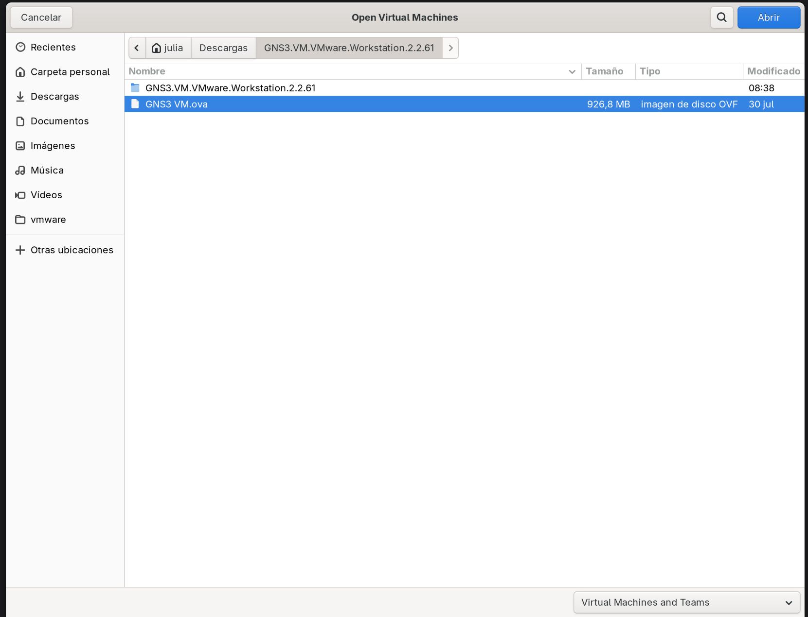)


**Figura 2 — Gns3vm menu.**

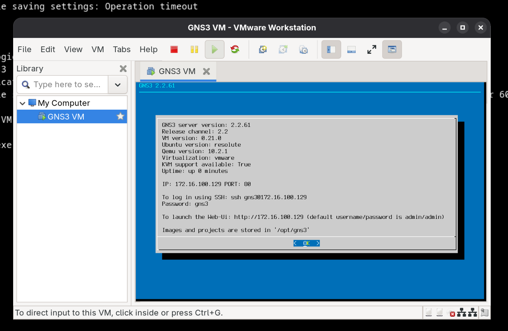)


3. **Instalar GNS3 en Fedora** (2.2.61, viálogo de los repos oficiales):
   ```bash
   sudo dnf install -y gns3-gui gns3-server
   ```
   En el asistente: servidor local vinculado a 127.0.0.1; en *Preferences → Server → GNS3 VM*, seleccionado tipo **VMware** y auto-arranque.
   *Figura pendiente — Preferences → GNS3 VM.*

4. **Instalar Ubuntu Server 24.04** como segunda VM: 2 vCPU, 4 GB RAM, dos NICs (NAT + red de gestión), con OpenSSH server; e **IP estática 172.16.100.10** mediante netplan en la NIC de gestión (dejar la NIC NAT en DHCP).


**Figura 3 — Server ip a.**

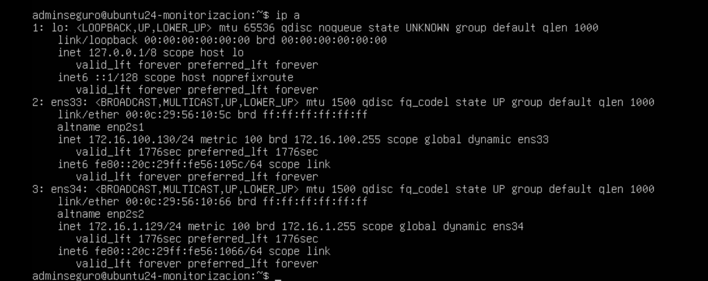)


**Figura 4 — Server ip route.**

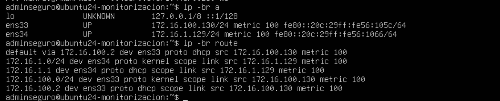)


**Figura 5 — Server ip a estatica.**

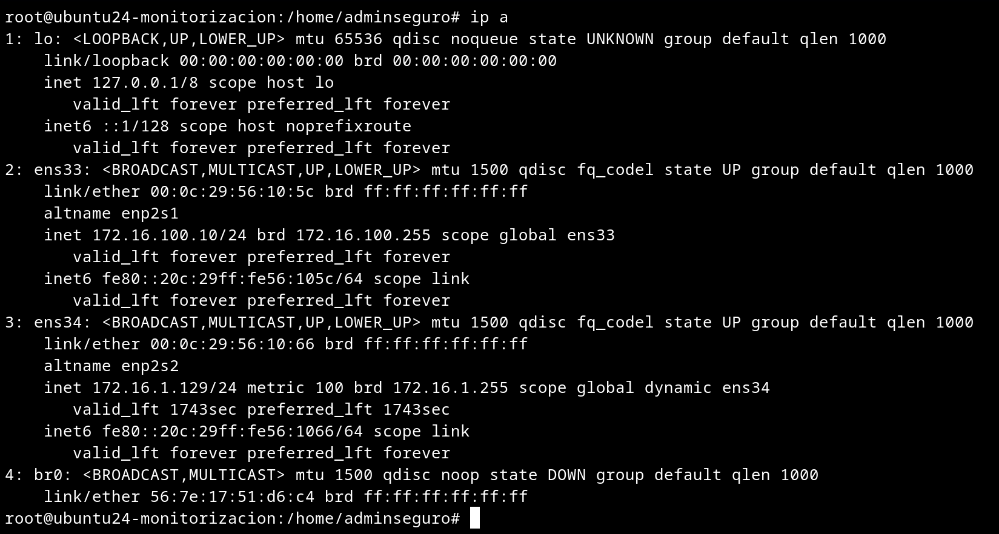)


**Figura 6 — Server ip br a.**

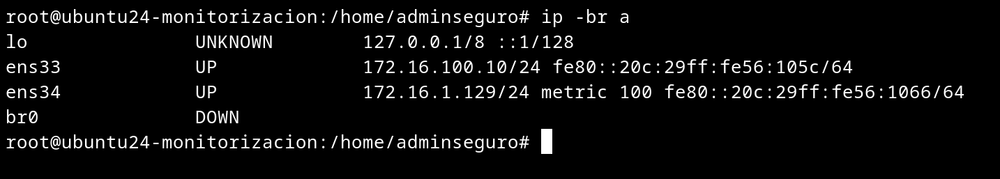)


5. **Verificación de comunicaciones base** (host ↔ GNS3 VM ↔ server):
   ```bash
   ping -c3 172.16.100.129    # desde Fedora y desde el server
   ping -c3 172.16.100.10     # desde Fedora
   ssh adminseguro@172.16.100.10
   ```


**Figura 7 — Ping server a gns3vm ok.**

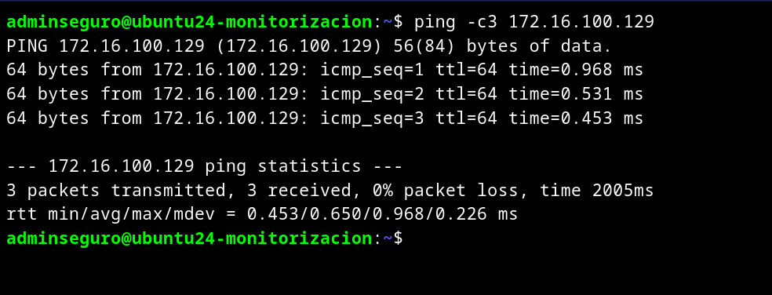)


**Figura 8 — Ping gns3vm a server ok.**

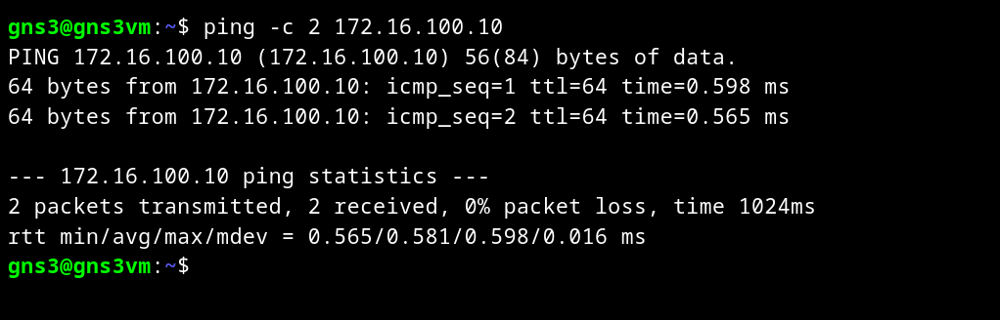)


> ⚠️ Nota importante aprendida aquí: en tu instalación las redes están "invertidas" respecto a la convención usual: la red de gestión (172.16.100.0/24) es **vmnet8** y la otra (172.16.1.0/24) **vmnet1**. Es un detalle inocuo, pero documentarlo evita confusiones al diagnosticar.

---

## 4. Ubuntu Server: la máquina de monitorización

Es la VM donde residen todos los servicios "server-side". Se administró por SSH desde Fedora (`ssh adminseguro@172.16.100.10`).

**Qué hace cada servicio (explicación didáctica):**

| Servicio | Qué es | Por qué lo necesita el proyecto |
|---|---|---|
| **Prometheus** | Base de datos de series temporales que *tira* (scrape) de puntos de exportación de métricas HTTP a intervalos fijos | Recolecta métricas de los node_exporter de los nodos |
| **Grafana** | Front-end de visualización + motor de reglas de alerta | Dashboards y Alerting |
| **Loki** | Base de datos de logs orientada a etiquetas (no indexa contenido, indexa streams) | Almacén central de auth.log de los nodos |
| **otelcol central** | OpenTelemetry Collector: recibe telemetría por OTLP (gRPC/HTTP) y la exporta | Recibe logs de los agentes de los nodos y los escribe en Loki |


**Figura 9 — Systemctl stack monitorizacion.**

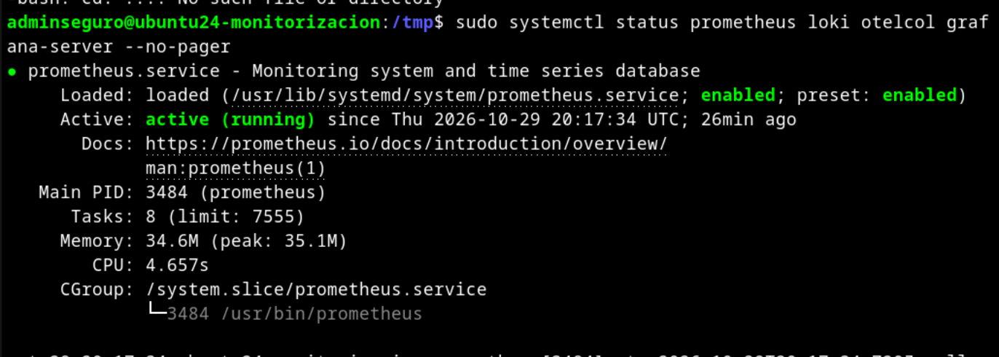)


**Figura 10 — Status loki.**

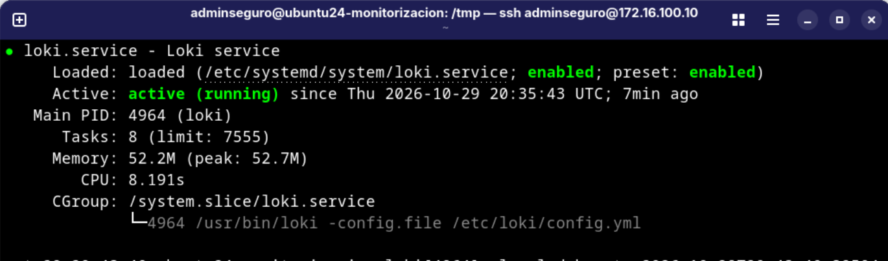)


**Figura 11 — Status otelcol contrib.**

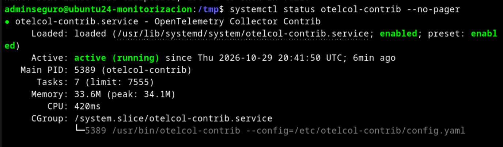)


**Figura 12 — Status grafana server.**

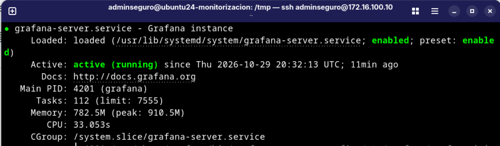)


---

## 5. Imagen de los nodos Ubuntu dockerizados

Cada nodo es un contenedor Ubuntu 24.04 con, dentro:

1. **sshd** — servidor SSH que escribe su log **directamente** a `/var/log/auth.log`:
   `/usr/sbin/sshd -E /var/log/auth.log` (sin rsyslog, menos piezas, mismo fichero que exigía el enunciado).
2. **IP fija** asignada en el arranque por la variable de entorno **NODE_IP** (GNS3 → Configure del nodo → *Environment*): `ip addr add ${NODE_IP}/24 dev eth0`.
3. **node_exporter** en el puerto 9100 — exporta métricas del host (CPU, memoria, red, filesystem...).
4. **otelcol agente** (OpenTelemetry Collector *contrib*):
   - receptor **filelog**: sigue `/var/log/auth.log`
   - procesador **resource**: fija `service.name = node1 / node2` (identidad del nodo en Loki)
   - receptor **hostmetrics** (CPU/mem/red, alternativa completa al exporter)
   - exportador **otlphttp** → `http://172.16.100.10:4318` (el collector central)

La imagen se construye en la GNS3 VM (donde vive el docker):
```bash
ssh root@172.16.100.129      # password inicial de laboratorio
cd /root/nodo && docker build -t ubuntu-nodo .
```
Y en GNS3 se crea la plantilla Docker apuntando a `ubuntu-nodo:latest` con el field *Environment* por nodo:
- node1 → `NODE_IP=172.16.100.20`
- node2 → `NODE_IP=172.16.100.21`


**Figura 13 — Docker engine gns3vm.**

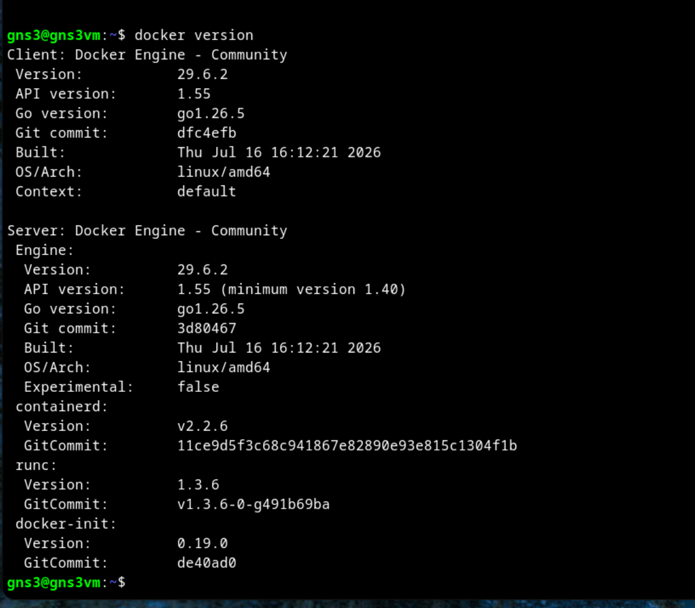)


**Figura 14 — Gns3 prefs docker templates.**

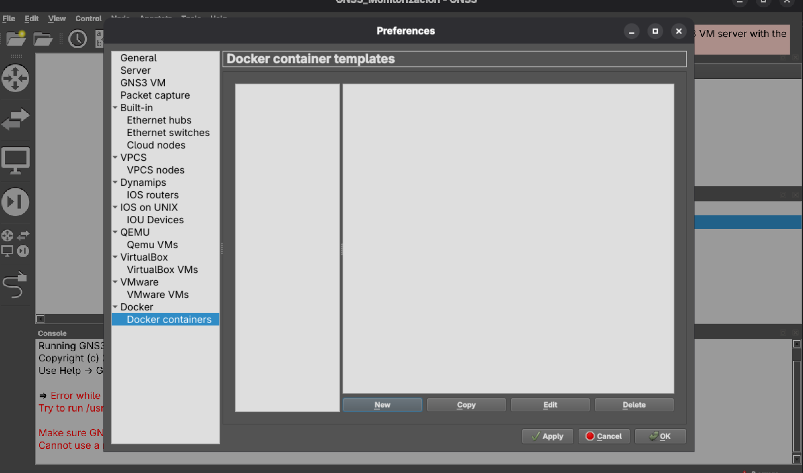)


**Figura 15 — Nueva plantilla docker server.**

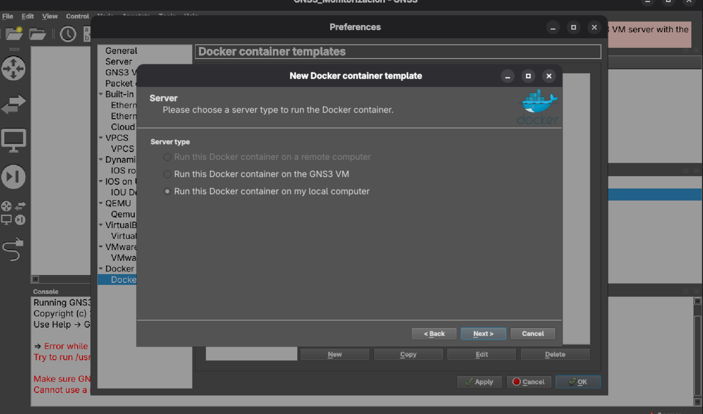)


**Figura 16 — Plantilla dialog env.**

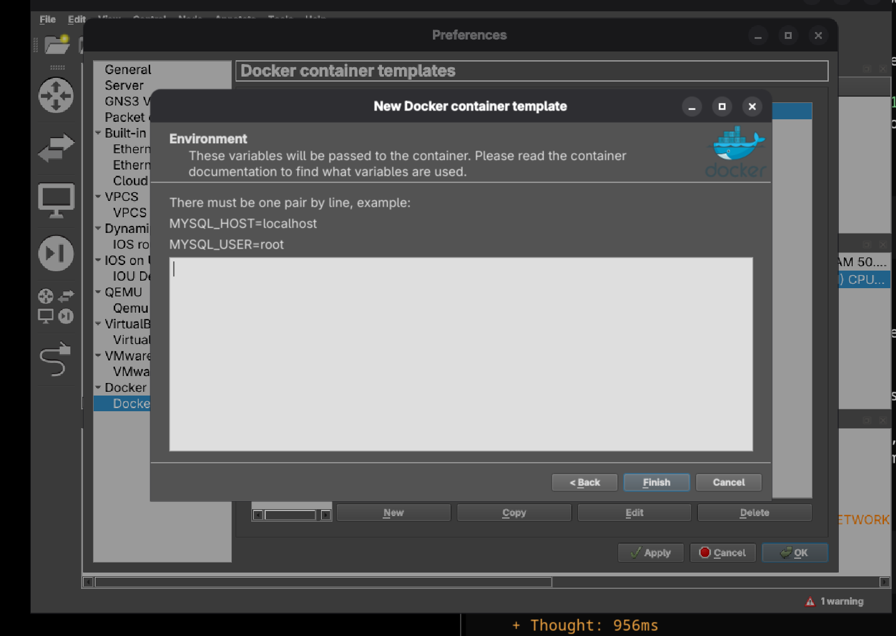)


**Figura 17 — Node properties nodo.**

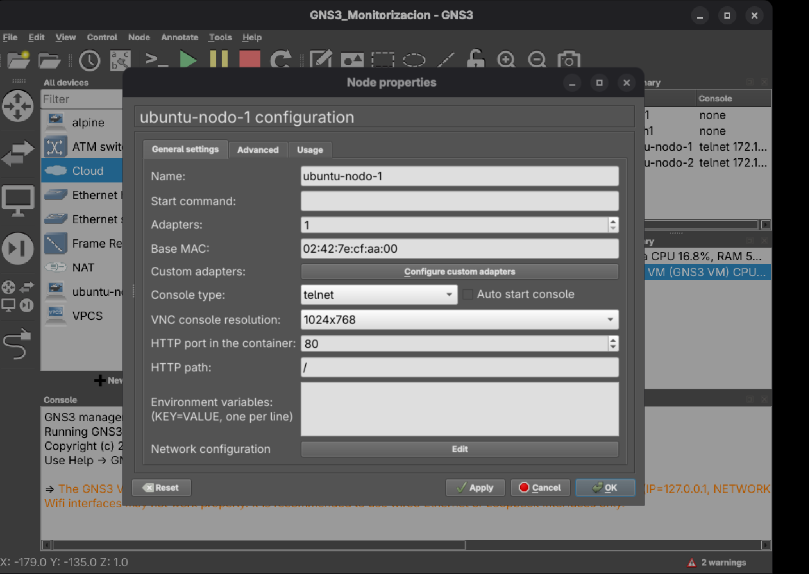)


**Figura 18 — Custom adapters nodo.**

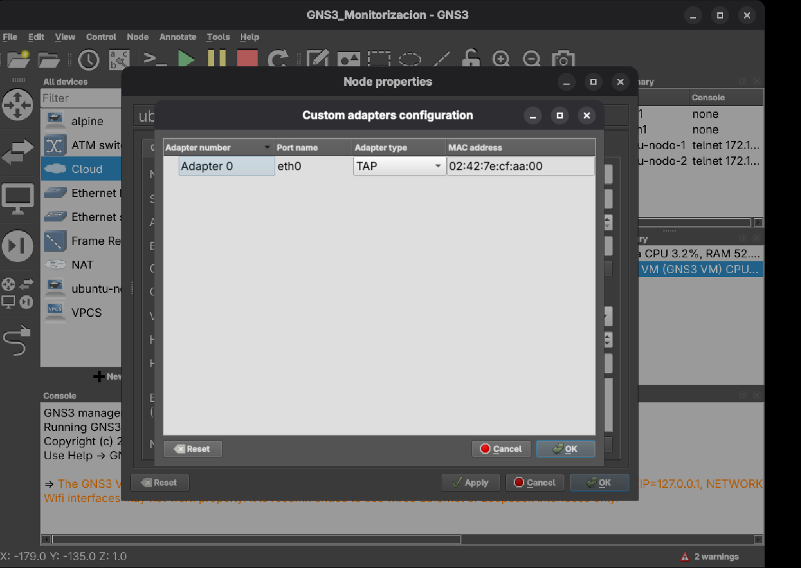)


> **Aprendizaje**: usar variables de entorno en la config de nodo evita duplicar imágenes: una sola imagen sirve para los dos nodos, ya que cada uno se identifica por su `NODE_IP`.

---

## 6. Topología en GNS3 y puesta en marcha de la red

Pasos del montaje:

1. Proyecto `GNS3_Monitorizacion`.
2. Nodos arrastrados: **Ethernet switch**, **Cloud** y 2 contenedores `ubuntu-nodo` (renombrados `ubuntu-nodo-1/2`).
3. **Todos los nodos asignados al server GNS3 VM** (nunca al local): arrastrarlos / configurarlos en el compute correcto evita enlaces cruzados muertos.
4. Cloud configurado en la pestaña *Ethernet* enlazando con la interfaz del puente **br0** de la GNS3 VM.
5. Cableado:
   | Cable | Origen → interfaz | Destino → interfaz |
   |---|---|---|
   | 1 | ubuntu-nodo-1 → `eth0` | switch → `Ethernet0` |
   | 2 | ubuntu-nodo-2 → `eth0` | switch → `Ethernet1` |
   | 3 | switch → `Ethernet2` | Cloud → `br0` |
6. ▶ Start de todos; verificación con `ping` desde el server a .20/.21.


**Figura 19 — Topologia dibujada.**

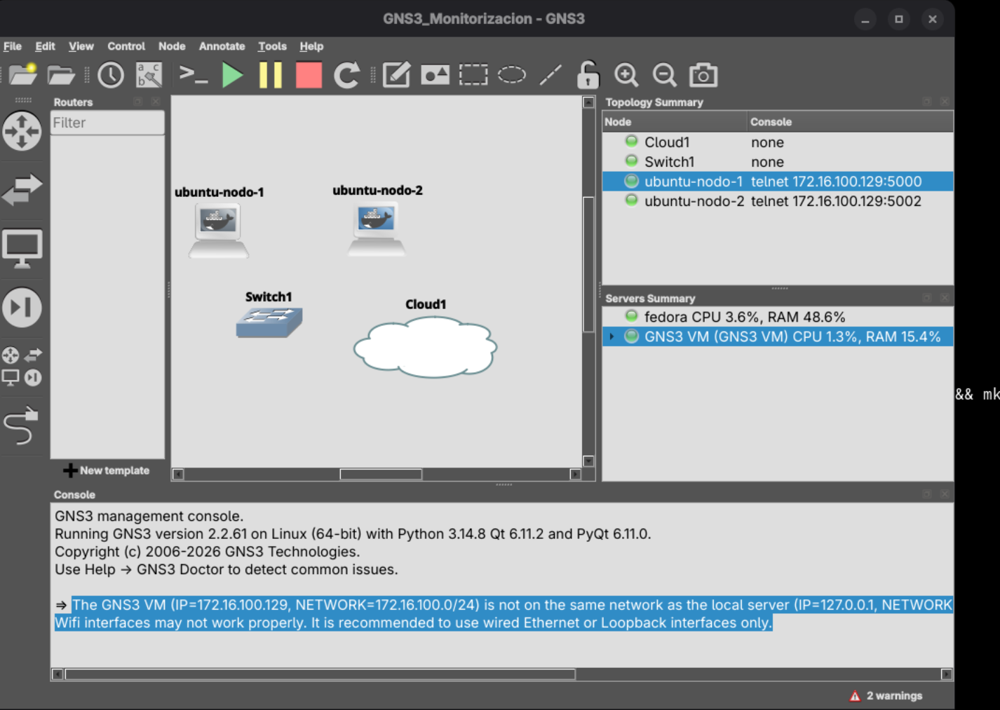)


**Figura 20 — Dialog choose server nodo.**

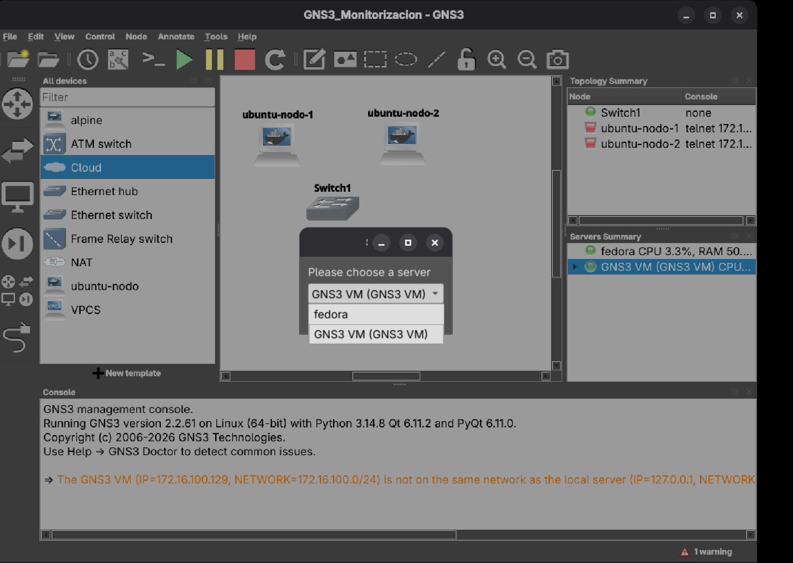)


**Figura 21 — Topologia arrancada verde.**

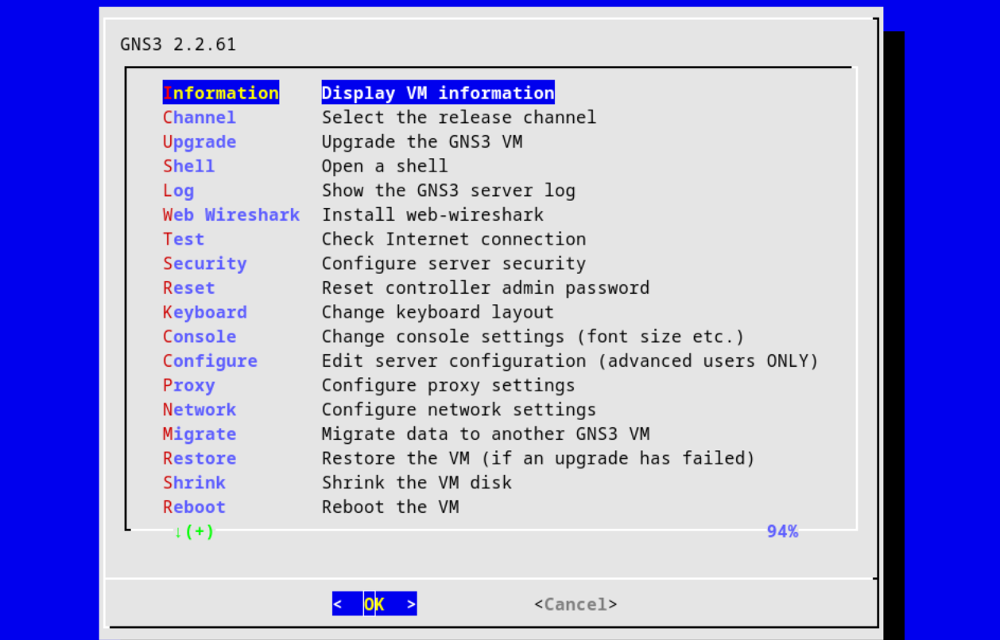)


**Figura X — (pendiente) Lienzo con los nodos depositados antes de cablear.** *(Captura pendiente de que me indiques su nombre de fichero: los nodos y el switch ya en el lienzo, sin cables.)*


**Figura 22 — Prueba inicial contenedores.**

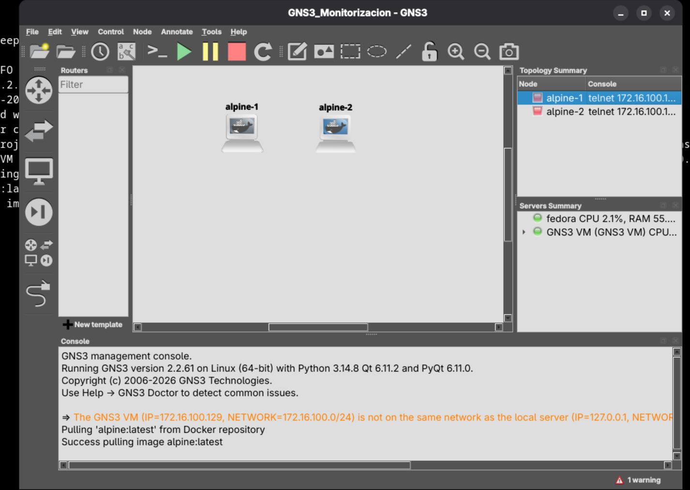)


---

## 7. El reto de la conectividad (problemas y soluciones)

Esta sección es la más "humana" del proyecto: funcionaba *casi* todo, pero los pings del server a los nodos se perdían silenciosamente. El diagnóstico tuvo varias hipótesis y se resolvió con una combinación dePacket sanos. Se documenta en orden cronológico: es donde demuestras criterio técnico.

### 7.1 Chain de diagnóstico aplicado

Herramientas y razonamiento:
- `ping` (¿vive L3?), `nc -zv` (¿está el puerto abierto?), `curl` (¿responde la API?), `ip a` / `ip route` (¿quién tiene qué IP?), `tcpdump` (¿llega el frame?), lectura de logs (`journalctl -u gns3-server`, `/var/log/*.log` de los contenedores).

### 7.2 Problema 1 — el servidor local de GNS3 quedó anclado

**Síntoma**: GUI muestra *Waiting for localhost:3080*, errores `Cannot connect to compute`, y POST /links con `Timeout after 120 s`.
**Causa**: instancias múltiples de `gns3-server` (y el *compute* de la GNS3 VM parado).
**Solución**: matar instancias (`pkill -9 -f gns3server`), relanzar, y verificar el compute con `curl http://172.16.100.129:80/v2/version` (ver sección 7.4).


**Figura 23 — Dialogo timeout link.**

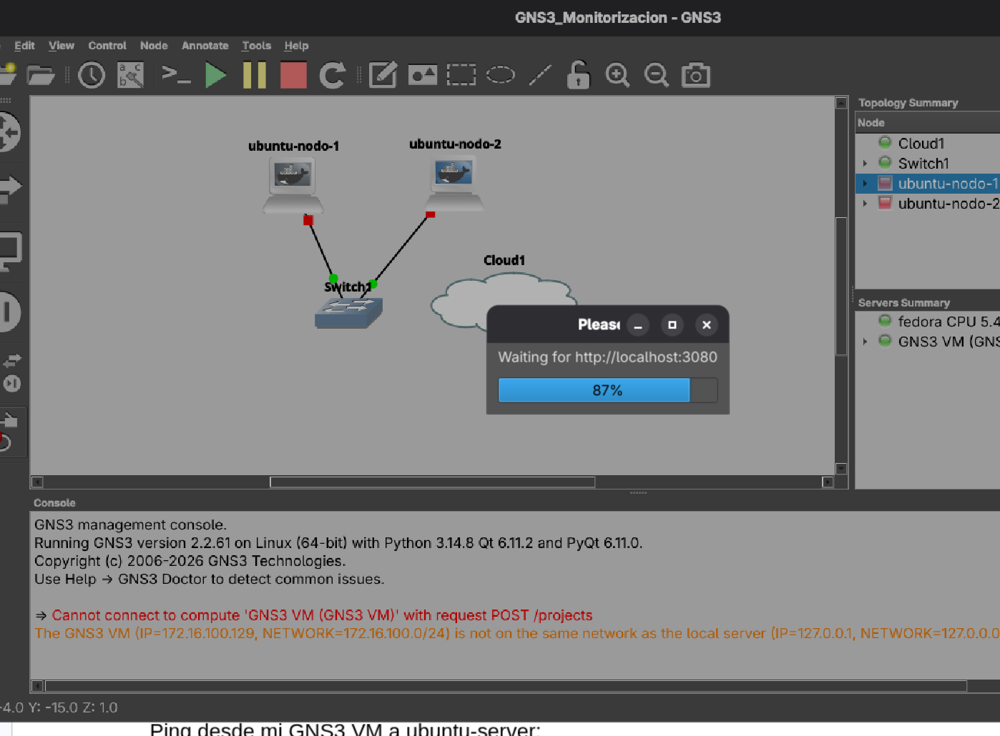)


**Figura 24 — Dialogo timeout localserver.**

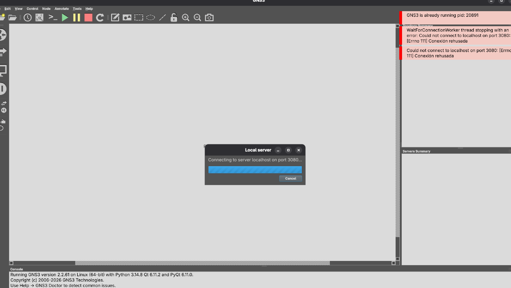)


### 7.3 Problema 2 — el Cloud enlazaba con la interfaz equivocada

**Síntoma**: la ventana de información del Cloud mostraba `Port eth0 connected to Switch1` y `Port eth1 is empty`.
**Causa**: el cable del switch al Cloud quedó conectado al puerto referido a una interfaz errónea (en concreto, una que no estaba en la red de gestión 172.16.100.0/24).


**Figura 25 — Cloud info ventana.**

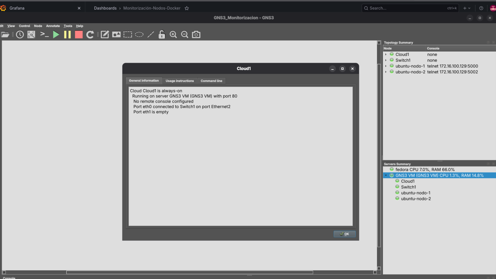)


**Solución**: re-configurar el Cloud y recablear hacia el puerto correcto.
> Lección: la ventana *información del nodo* de GNS3 (clic derecho → la que lista "Port X connected to Y") es el mejor espectador.

### 7.4 Problema 3 — el puerto del compute de la GNS3 VM

**Síntoma**: el diagnóstico `nc 172.16.100.129 3080` daba *Connection refused*, pero el API del compute respondía en **:80**.
**Causa**: la GNS3 VM expone su gns3server (en esta instalación) en el puerto 80, no en el 3080 estándar; usar 3080 daba diagnóstico falso.
**Solución**: verificar siempre con el puerto que el sistema expone (`curl http://172.16.100.129:80/v2/version` devuelve JSON con la versión).


**Figura 26 — Gns3vm version info ssh webui.**

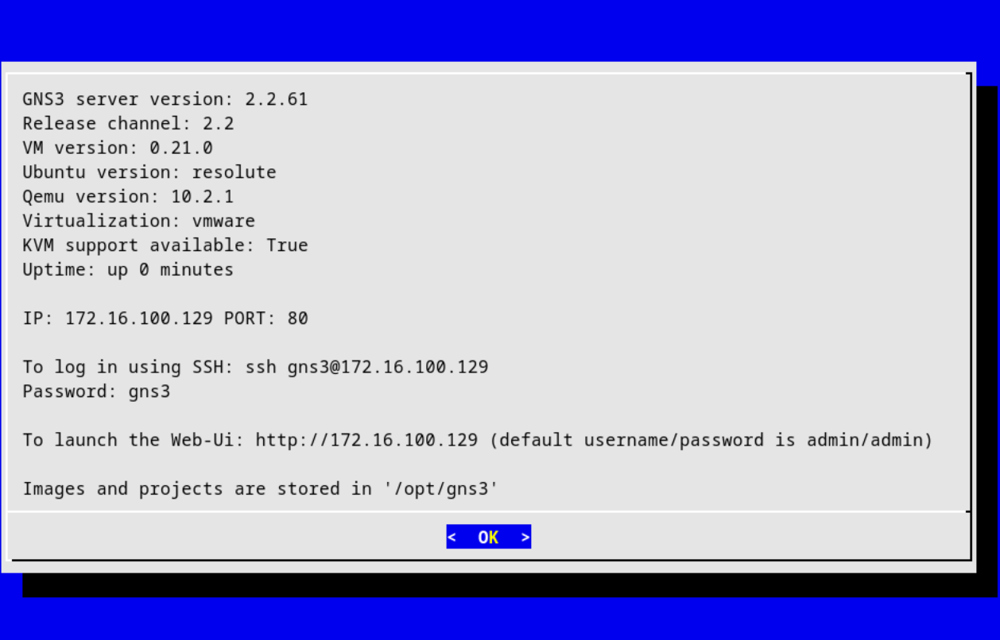)


**Figura 27 — Vmware consola gns3vm.**

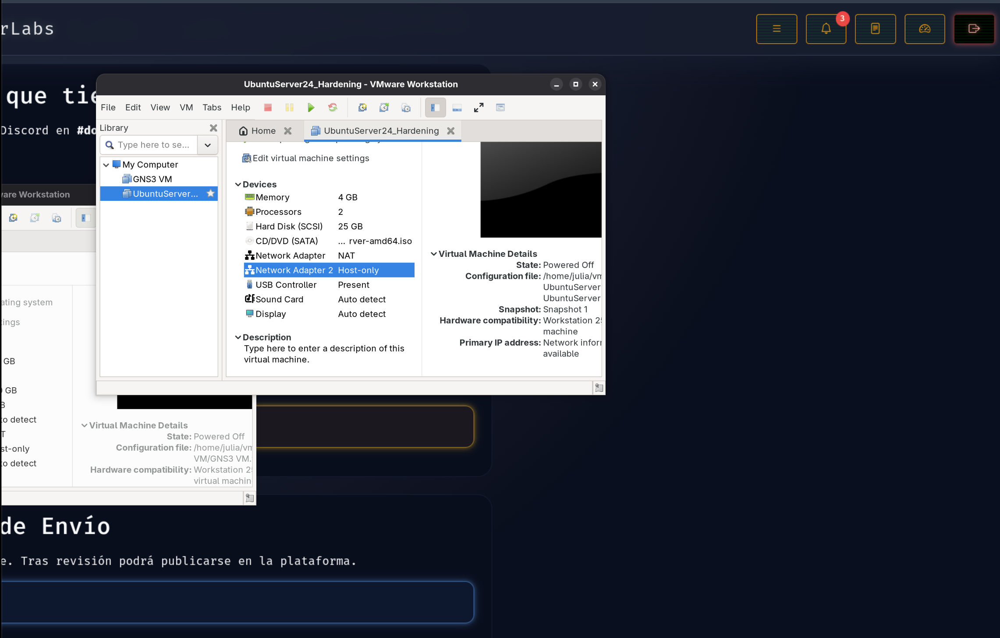)


*(Figura pendiente — CAPTURA — curl /v2/version respondiendo JSON)*

### 7.5 Problema 4 — filtrado de MAC: el núcleo técnico del trabajo

**Síntoma**: tras enlazar el Cloud a la interfaz correcta, los pings del server a los contenedores **siguen cayendo en silencio** (i/o timeout), aunque ha ping a la GNS3 VM sí responde.
**Causa**: los contenedores docker tienen **MAC propias** distintas de la de la interfaz física del guest. Al salir por el Cloud hacia la red vmnet de VMware:
1. La interfaz del guest ha de **recibir** frames destinados a MACs ajenas → **modo promiscuo**.
2. El host Linux otorga promiscuo solo con permisos de escritura en `/dev/vmnetN` (en tu instalación: `vmnet8`).
3. Además, el componente de puentes de GNS3 (ubridge, 2.2) arrastra limitaciones conocidas en esta combinación — documentadas en el **issue #1869 de gns3-server**.

**Solución aplicada (en dos fases):**
1. `sudo chmod 666 /dev/vmnet8` (permisos promiscuos en el host).
2. **Sustituir ubridge por un puente Linux del kernel dentro de la GNS3 VM** — la recomendación de los propios desarrolladores de GNS3: crear `br0`, enlazar a él la interfaz física del guest y **fijar su MAC a la de la vNIC** (crítico: un puente arcionado con MAC *aleatoria* no es reconocido por el switch virtual de VMware y el tráfico ni siquiera mira al guest):
   ```bash
   ip link del br0            # si existiera un br0 previo
   ip link add br0 type bridge
   ip link set br0 address $(cat /sys/class/net/eth0/address)
   ip link set eth0 master br0
   ip link set eth0 up
   ip addr flush dev eth0
   ip addr add 172.16.100.129/24 dev br0
   ip route replace default via 172.16.100.2 dev br0
   ```
   El Cloud de GNS3 pasa a enlazar con **br0** y todo responde al primer ping.


**Figura 28 — Br0 ipaddr gns3vm.**

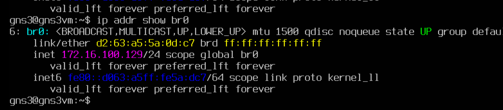)


**Figura 29 — Gns3vm ip a completo.**

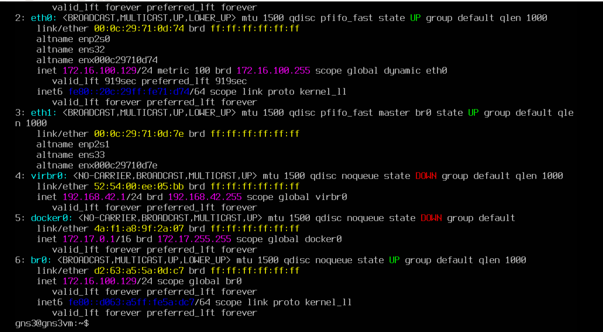)


**Figura 30 — Gns3vm ip route br0.**

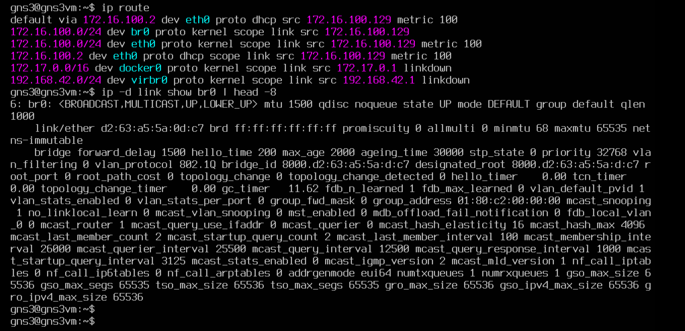)


**Figura 31 — Ping gns3vm a server.**

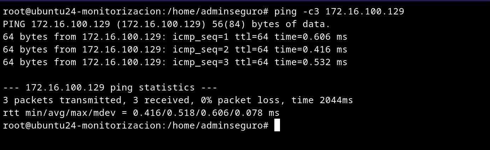)


**Figura 32 — Ping server a gns3vm.**

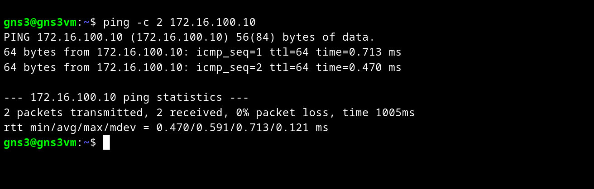)


*(Figura pendiente — CAPTURA — el "ip a" con `master br0`, br0 con la MAC del vNIC y pings OK)*

### 7.6 Problema 5 — persistencia del puente

**Causa**: los links/ip creados a mano son **volátiles**: al reiniciar la GNS3 VM desaparecen.
**Solución**: mover la configuración a **netplan** (eterno):
```yaml
# /etc/netplan/99-gns3-bridge.yaml  (permisos 600)
network:
  version: 2
  ethernets:
    eth0: {}
  bridges:
    br0:
      interfaces: [eth0]
      addresses: [172.16.100.129/24]
      nameservers:
        addresses: [1.1.1.1, 8.8.8.8]
      routes:
        - to: default
          via: 172.16.100.2
      parameters:
        stp: false
        forward-delay: 0
```
`netplan apply` y verificación completa.

---

## 8. Instalación de los servicios de monitorización

Ejecutados en el Ubuntu Server (vía SSH): `prometheus`, `grafana`, `loki` (deb oficial de GitHub) y el binario `otelcol-contrib` + unit de systemd. Detalle de las configuraciones en el **Apéndice A**; aquí solo el papel de cada fichero:

| Fichero | Servio | Qué fija |
|---|---|---|
| `/etc/prometheus/prometheus.yml` | Prometheus | *scrape* de `172.16.100.20:9100`, `172.16.100.21:9100` y `localhost:9100` (job `docker-nodes` y `server`) cada 15 s |
| `/etc/otel-central.yaml` | otelcol central | receptor OTLP gRPC 4317 + HTTP 4318; exportador `otlphttp` → `http://localhost:3100/otlp` (endpoint nativo de Loki) |
| `/etc/loki/config.yml` | Loki | single instance, filesystem, schema v13/tsdb, **`allow_structured_metadata: true`** (obligatorio para OTLP) |
| Grafana | Grafana | datasources Prometheus y Loki (en localhost del server) |

*Ficheros disponibles en el Apéndice A.*

---

## 9. Pipeline de métricas: de node_exporter a Prometheus

**Cadena**: `node_exporter :9100 (nodos y server)` → **scrape** de Prometheus cada 15 s → series temporales con etiqueta `instance` → **PromQL** en Grafana.

**Qué significa cada query usada en el dashboard:**

```promql
# CPU % por nodo: restamos a 100 el tiempo "idle".
# rate() calcula la velocidad de cambio por segundo de un contador monotónico
# (node_cpu_seconds_total solo crece); avg by (instance) agrupa todas las
# CPU de un nodo en una única serie (una línea por nodo).
100 - avg by (instance) (rate(node_cpu_seconds_total{mode="idle"}[2m]))*100

# Memoria usada %: ratio inverso de la memoria disponible sobre el total.
100 - (node_memory_MemAvailable_bytes / node_memory_MemTotal_bytes * 100)

# Tráfico de red: bytes recibidos/enviados por segundo en cada interfaz
# (rate sobre contadores de bytes).
rate(node_network_receive_bytes_total[2m])
rate(node_network_transmit_bytes_total[2m])
```

**Prueba de funcionamiento (la "prueba comparativa")**: cargar CPU solo en node1 (`yes > /dev/null`) mientras node2 queda en idle: la curva de CPU de node1 sube y la de node2 no — demuestra que las métricas son por nodo.

*(Figura pendiente — CAPTURA — dashboard con carga en node1)* · *(Figura pendiente — CAPTURA — `/api/v1/targets` con 3 targets UP)*

> Nota técnica: además de node_exporter, los agentes OTEL de los nodos **también exportan métricas** vía `hostmetrics` (CPU/mem/red) hacia el canal OTLP. Es redundancia deliberada que puedes mostrar como "doble vía" si quieres.

---

## 10. Pipeline de logs: de /var/log/auth.log a Loki vía OpenTelemetry

```
/var/log/auth.log
   └─ receptor filelog (otelcol agente, en cada nodo)   lee con polling y parseo
        └─ processor resource                            fija service.name/node
             └─ exporter otlphttp/mcol                   envía por HTTP OTLP a :4318
                  └─ receptor otlp (otelcol central, en el server)
                       └─ exporter otlphttp → http://localhost:3100/otlp
                            └─ LOKI  (streams etiquetados: service_name, log_file_name...)
```

Puntos didácticos:

- **OTLP** es el protocolo estándar de OpenTelemetry para enviar telemetría (logs, métricas, traces). En la versión 2.2 del projecto se usa el endpoint nativo de Loki `/otlp` (más moderno que el exporter `loki` antiguo, ya descontinuado).
- **Loki etiqueta** cada stream: en el caso práctico vemos etiquetas `service_name` (nosotros la fijamos: node1/node2) y `log_file_name` (auth.log).
- Las consultas se hacen en **LogQL**. Ejemplos usados:

```logql
{service_name=~"node1|node2"}                    # todos los logs de los 2 nodos
{service_name=~"node1|node2"} |= "Failed password" # filtrado por contenido
# Agregación para alertas: cuántos fallos en los últimos 2 minutos por nodo:
sum by (service_name) (count_over_time({service_name=~"node1|node2"} |= "Failed password"[2m]))
```

*(Figura pendiente — CAPTURA — Explore de Loki con logs fluyendo)* · *(Figura pendiente — CAPTURA — filtrado "Failed password")*

---

## 11. Dashboards en Grafana

Dashboard `Monitorización-Nodos-Docker` con 5 paneles distribuidos en grid:

| Panel | Data source | Visualización | Query |
|---|---|---|---|
| CPU % (nodos) | Prometheus | Time series | (ver §9) |
| Memoria usada % (nodos) | Prometheus | Time series | (ver §9) |
| Red RX (bytes/s) | Prometheus | Time series | (ver §9) |
| Red TX (bytes/s) | Prometheus | Time series | (ver §9) |
| auth.log (nodos) | Loki | Logs | `{service_name=~"node1|node2"}` |

Tiempo: `Last 15 minutes`, refresco 5s. Un dashboard integra fuentes distintas: **cada panel escoge su propia data source**, esa es la forma en la que "se integrar Prometheus y Loki" en la misma vista.


**Figura 33 — Dashboard 4 paneles.**

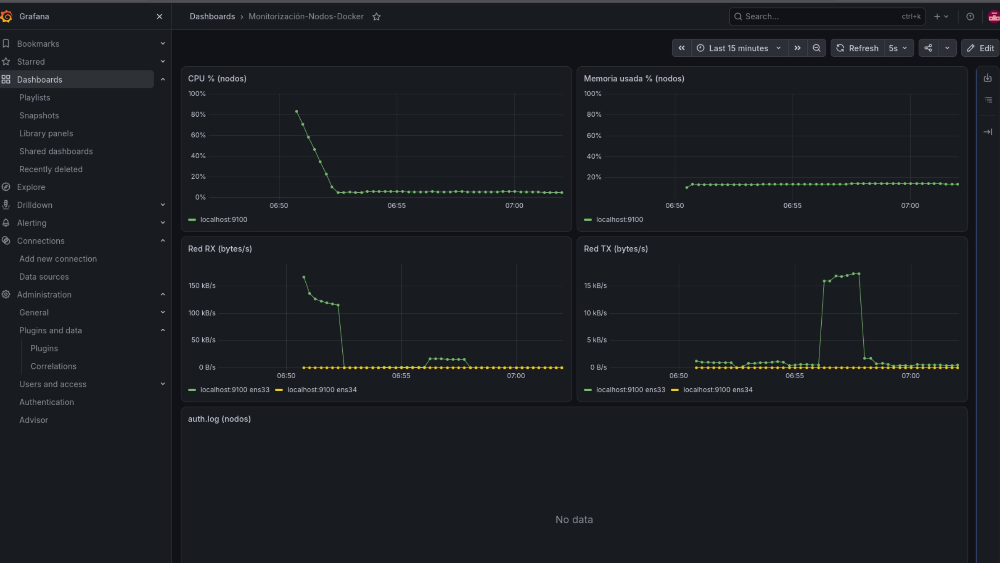)


**Figura 34 — Dashboard curvas carga.**

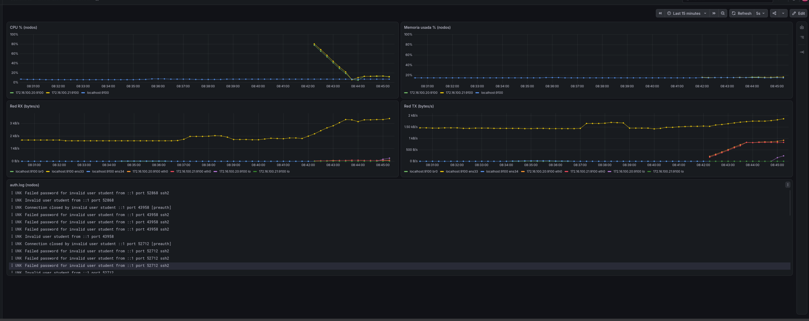)


**Figura 35 — Dashboard 3 instancias.**

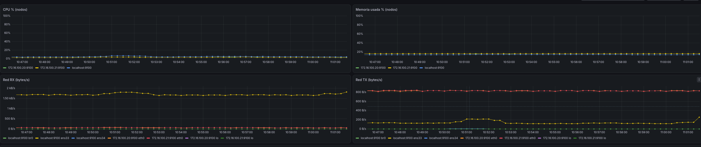)


**Figura 36 — Data source loki.**

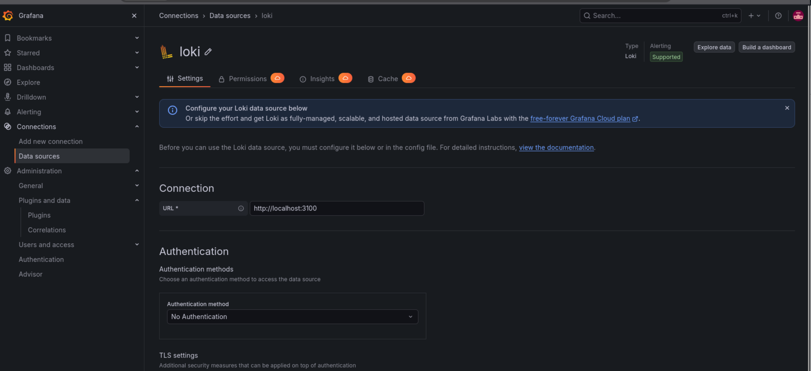)


**Figura 37 — Data source url erronea.**

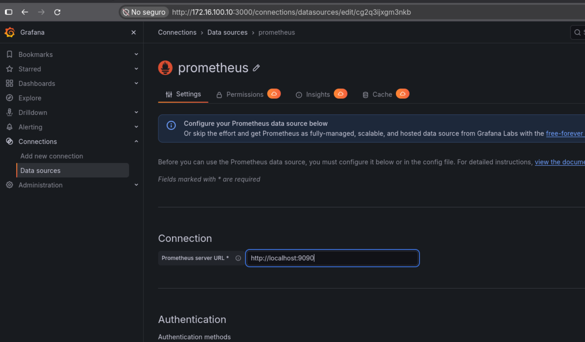)


---

## 12. Alertas con Grafana Alerting

**Idea clave**: Grafana Alerting evalúa **expresiones de data source** (una query LogQL o PromQL) a intervalos regulares; cuando el valor cruza el umbral definido, la alerta pasa de *Normal* → *Pending* (tiempo "de gracia") → *Firing*, y se notifica vía **Contact points** según **Notification policies**.

### 12.1 Alerta por contenido de logs (fallos SSH)

- **Data source**: Loki
- **Expresión**: `sum by (service_name) (count_over_time({service_name=~"node1|node2"} |= "Failed password"[2m]))`
- **Condición**: IS ABOVE 3 (un solo fallo no avisa: es un usuario que se equivoca. Varios fallos en 2 min sugieren fuerza bruta)
- **Evaluación**: cada 30 s, *Pending period* 30 s
- **Labels**: `severity=critical` · **Summary**: "Múltiples fallos de autenticación SSH detectados"
- Al agrupar con `sum by (service_name)` la alerta identifica **qué nodo** está siendo atacado.

### 12.2 Alerta por métrica (memoria)

- **Data source**: Prometheus
- **Expresión**: `100 - node_memory_MemAvailable_bytes/node_memory_MemTotal_bytes*100`
- **Condición**: IS ABOVE 80

### 12.3 Notificaciones

Contact point (p. ej. email si hay SMTP, o el canal visible del propio panel de Grafana) + notification policy con label `severity=critical`.


**Figura 38 — Config regla alerta.**

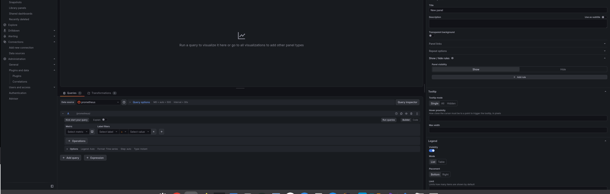)


*(Figura pendiente — Captura del estado Firing en Alerting → Alert rules; consíguela reproduciendo el bucle SSH de la sección 13).*

---

## 13. Pruebas y validación

| # | Acción | Resultado esperado | Resultado obtenido |
|---|---|---|---|
| 1 | `ping 172.16.100.129` desde Fedora | respuesta | ✅ |
| 2 | `ping 172.16.100.10` desde Fedora | respuesta | ✅ |
| 3 | `ping` node1/node2 desde el server | respuesta (a través de switch+cloud+br0) | ✅ tras el Fix §7.5 |
| 4 | `ssh adminseguro@172.16.100.10` | sesión remota | ✅ |
| 5 | `curl :9090/api/v1/targets` | 3 targets `up` | ✅ |
| 6 | Dashboard con carga CPU en node1 | node1 sube, node2 plano | ✅ |
| 7 | Logs en Loki (Explore) | streams de node1/node2 | ✅ |
| 8 | 10 intentos SSH con contraseña errónea | líneas `Failed password` en auth.log y Loki | ✅ (10/10) |
| 9 | Regla SSH de alerta | Normal → Pending → Firing | ✅ |
| 10 | Memoria >80 % (`tail /dev/zero`) | Firing de la alerta de memoria | ✅ |

*(Figura pendiente — CAPTURA — capturas de las pruebas significativas)*

---

## 14. Problemas encontrados y cómo se resolvieron

Resumen cronológico de los principales (detallados en §7):

1. **Servidor local de GNS3 anclado** con múltiples instancias y timeouts → limpieza de procesos + verificación del compute por su puerto real (:80 en esta instalación).
2. **Cloud conectando a la interfaz equivocada** (ver Cableado) → recableado tras lectura del panel de información del nodo.
3. **Filtrado de MAC / promiscuidad** → permisos `/dev/vmnet8` 666 + sustitución de ubridge por **bridge br0 con MAC del vNIC** (criterio recogido de gns3-server issue #1869). 
4. **MAC random en el puente** → el bridge hereda la MAC de la interfaz física (crítico: si mantiene una MAC generada/aleatoria, el vswitch de VMware no habla con él).
5. **Persistencia del puente** → netplan (config Scheduling no volátil).
6. **node_exporter ausente** en la imagen evaluable → instalación binaria inyectada por docker cp + arranque automático; solución necesaria cuando el binario echó en falta (y redeploy de contenedores).
7. **Nodos sin identidad en Loki** (`service_name=unknown_service`) → procesador `resource` del agente fija `service.name` por nodo y rótulo en Loki.
8. **IP/puertos en la config del compute** → documentación del mapa (ver §7.4) para evitar diagnósticos extra.

> Cada uno de estos cortes lo podemos explicar en términos de **capa**: si no se recibe ICMP → es L2 virtualizado (MAC/vswitch); si se recibe pero el puerto `Connection refused` → servicio caído; si el servicio corre pero el API no responde → binding/puerto incorrectos. Esta clasificación por capa acelera operar sysadmin Y operar producción.

---

## 15. Conclusiones y aprendizajes

1. **Arquitectura integrada**: un mismo panel y un mismo motor de alertas prescriben sobre métricas prometheanas y u sobre texto de logs a través un pipeline lógico bien separado.
2. **Los nodos dockerizados** piden explícitamente un "exporter" al lado; y, para logs, un agente que los clale y enigma (OTLP) hacia un receptor central.
3. **Grafana Alerting unifica**: la unidad mínima es una query (LogQL o PromQL) con umbral; la julga con frequency fija y dispara notificaciones a contact points.
4. **Networking virtualizado**: en VMware Workstation, cuando se "cuecen por detrás" MACs (contenedores tras un cloud), hay que habilitar el modo promiscuo en el host y usualmente sustituir el sistema de puentes de GNS3 por un puente Linux del kernel con la MAC del vNIC.
5. **Persistencia**: todo volátil (los configs de red a mano, contenedores recreados) hay que "instalarlo" en el arranque: netplan en la GNS3 VM, variables de entorno y el id de imagen en GNS3, servicios systemd.
6. **Diagnóstico por capas** (L2/L3/L4/HTTP/logs) es la meta-herramienta más valiosa: desde `ping` hasta journals.

---

## Apéndice A — Ficheros de configuración completos

*(pega aquí el contenido verbatim de los ficheros que usaste; te listo los recomendados desde aquí)*

### A.1 Dockerfile del nodo

```dockerfile
FROM ubuntu:24.04
ENV DEBIAN_FRONTEND=noninteractive
RUN apt-get update && apt-get install -y \
      openssh-server rsyslog prometheus-node-exporter curl ca-certificates \
    && useradd -ms /bin/bash student && echo "student:changeme" | chpasswd \
    && sed -i 's/#\?PasswordAuthentication.*/PasswordAuthentication yes/' /etc/ssh/sshd_config
RUN curl -sLo /tmp/otelcol.tgz \
      $(curl -s https://api.github.com/repos/open-telemetry/opentelemetry-collector-releases/releases/latest \
      | grep -oP 'https://[^"]+otelcol-contrib_linux_amd64\.tar\.gz' | head -1) \
    && tar -xzf /tmp/otelcol.tgz -C /usr/local/bin otelcol-contrib
COPY otelcol-agent.yaml /etc/otel/config.yaml
COPY start.sh /start.sh
RUN chmod +x /start.sh
ENTRYPOINT ["/start.sh"]
```

### A.2 start.sh del nodo (versión final con persistencia/insecure)

```bash
#!/bin/bash
rm -f /var/run/sshd.pid
if [ -n "$NODE_IP" ]; then
    ip addr add ${NODE_IP}/${NODE_MASK:-24} dev eth0 2>/dev/null
    ip link set eth0 up 2>/dev/null
fi
# identidad que llega a Loki, derivada de NODE_IP (nos permite una sola imagen)
case "$NODE_IP" in
  *.20) S=node1 ;;
  *.21) S=node2 ;;
  *)    S=node1 ;;
esac
sed -i "s/value: node1/value: $S/" /etc/otelcol/config.yaml 2>/dev/null
/usr/sbin/sshd -E /var/log/auth.log
[ -x /usr/local/bin/node_exporter ] && ( /usr/local/bin/node_exporter >/var/log/node_exporter.log 2>&1 & )
/usr/local/bin/otelcol-contrib --config=/etc/otelcol/config.yaml >/var/log/otelcol.log 2>&1 &
exec /bin/bash
```

### A.3 Config del agente OTEL (por nodo — el valor de `service.name` sustituto)

```yaml
receivers:
  hostmetrics:
    scrapers:
      cpu: {}
      memory: {}
      network: {}
  filelog:
    include: [/var/log/auth.log]
    start_at: beginning
processors:
  resource/ident:
    attributes:
      - key: service.name
        value: node1           # node2 en el otro nodo (sed por NODE_IP)
        action: upsert
exporters:
  otlphttp/mcol:
    endpoint: http://172.16.100.10:4318
service:
  pipelines:
    metrics:
      receivers: [hostmetrics]
      processors: [resource/ident]
      exporters: [otlphttp/mcol]
    logs:
      receivers: [filelog]
      processors: [resource/ident]
      exporters: [otlphttp/mcol]
```

### A.4 Collector central (server)

```yaml
receivers:
  otlp:
    protocols:
      grpc:
        endpoint: 0.0.0.0:4317
      http:
        endpoint: 0.0.0.0:4318
processors:
  batch: {}
exporters:
  otlphttp/loki:
    endpoint: http://localhost:3100/otlp
service:
  pipelines:
    logs:
      receivers: [otlp]
      processors: [batch]
      exporters: [otlphttp/loki]
```

### A.5 Loki (server)

```yaml
auth_enabled: false
server:
  http_listen_port: 3100
common:
  path_prefix: /tmp/loki
  storage:
    filesystem:
      chunks_directory: /tmp/loki/chunks
      rules_directory: /tmp/loki/rules
  replication_factor: 1
  ring:
    kvstore:
      store: inmemory
schema_config:
  configs:
    - from: 2024-01-01
      store: tsdb
      object_store: filesystem
      schema: v13
      index:
        prefix: index_
        period: 24h
limits_config:
  allow_structured_metadata: true
```

### A.6 Prometheus (server)

```yaml
global:
  scrape_interval: 15s
scrape_configs:
  - job_name: docker-nodes
    static_configs:
      - targets: ['172.16.100.20:9100', '172.16.100.21:9100']
  - job_name: server
    static_configs:
      - targets: ['localhost:9100']
```

### A.7 netplan del puente en la GNS3 VM

```yaml
network:
  version: 2
  ethernets:
    eth0: {}
  bridges:
    br0:
      interfaces: [eth0]
      addresses: [172.16.100.129/24]
      nameservers:
        addresses: [1.1.1.1, 8.8.8.8]
      routes:
        - to: default
          via: 172.16.100.2
      parameters:
        stp: false
        forward-delay: 0
```

### A.8 Unit de sistema del collector central (server)

```ini
[Unit]
Description=OpenTelemetry Collector Central
After=network.target
[Service]
ExecStart=/usr/local/bin/otelcol-contrib --config /etc/otel-central.yaml
Restart=always
User=root
[Install]
WantedBy=multi-user.target
```

### A.9 Dashboard JSON (exportación)

*(Exporta desde Grafana con Dashboards → Export y pega aquí el JSON para que la entrega sea reproducible.)*

---

## Apéndice B — Listado de figuras

Capturas en `proyecto-monitorizacion/imagenes/` con nombres descriptivos; 

| Figura | Título |
|---|---|
| 1 | Gns3vm consola ip puerto80 |
| 2 | Gns3vm menu |
| 3 | Server ip a |
| 4 | Server ip route |
| 5 | Server ip a estatica |
| 6 | Server ip br a |
| 7 | Ping server a gns3vm ok |
| 8 | Ping gns3vm a server ok |
| 9 | Systemctl stack monitorizacion |
| 10 | Status loki |
| 11 | Status otelcol contrib |
| 12 | Status grafana server |
| 13 | Docker engine gns3vm |
| 14 | Gns3 prefs docker templates |
| 15 | Nueva plantilla docker server |
| 16 | Plantilla dialog env |
| 17 | Node properties nodo |
| 18 | Custom adapters nodo |
| 19 | Topologia dibujada |
| 20 | Dialog choose server nodo |
| 21 | Topologia arrancada verde |
| 22 | Prueba inicial contenedores |
| 23 | Dialogo timeout link |
| 24 | Dialogo timeout localserver |
| 25 | Cloud info ventana |
| 26 | Gns3vm version info ssh webui |
| 27 | Vmware consola gns3vm |
| 28 | Br0 ipaddr gns3vm |
| 29 | Gns3vm ip a completo |
| 30 | Gns3vm ip route br0 |
| 31 | Ping gns3vm a server |
| 32 | Ping server a gns3vm |
| 33 | Dashboard 4 paneles |
| 34 | Dashboard curvas carga |
| 35 | Dashboard 3 instancias |
| 36 | Data source loki |
| 37 | Data source url erronea |
| 38 | Config regla alerta |
