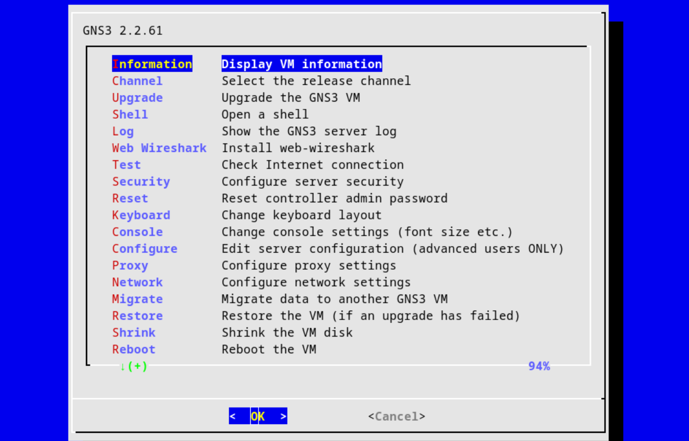
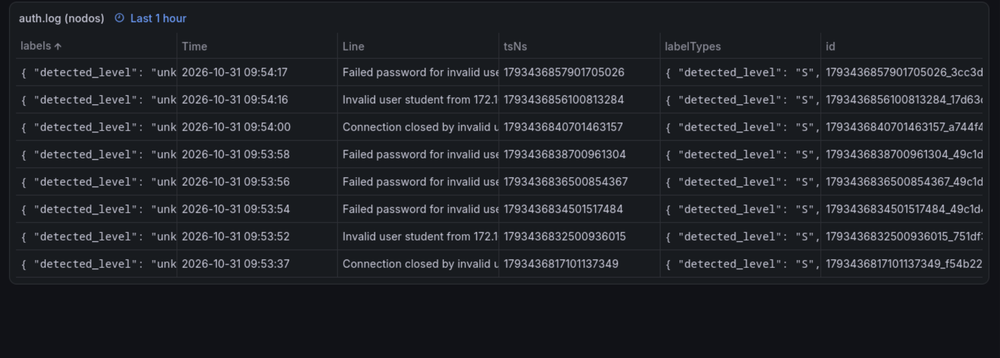
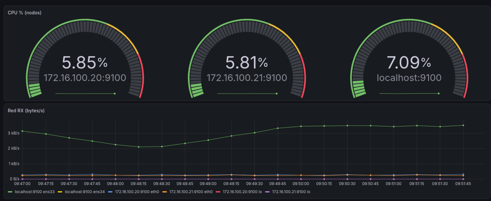
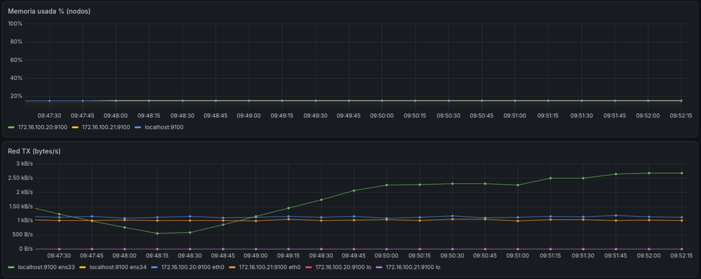

# 🛡️ Laboratorio de Monitorización y Detección — GNS3 · Prometheus · Grafana · Loki · OpenTelemetry

[](https://www.gns3.com/)
[](https://www.vmware.com/products/workstation-pro.html)
[](https://fedoraproject.org/)
[](https://grafana.com/)
[](https://prometheus.io/)
[](https://grafana.com/oss/loki/)
[](https://opentelemetry.io/)

> **Tarea de Bastionado de Redes** — Máster en Ciberseguridad.
> Laboratorio completo para monitorizar sistemas, centralizar logs y generar **alertas integradas** (métricas **y** logs) sobre una red virtual emulada con GNS3 dentro de VMware Workstation.

---

## Qué demuestra este proyecto

1. **Red virtual en GNS3** con dos nodos **Ubuntu 24.04 dockerizados**, un switch virtual y un **Ubuntu Server** de monitorización — GNS3 GUI en Fedora y el *compute* GNS3 corriendo dentro de **VMware Workstation**.
2. **Métricas de sistemas** (CPU, memoria, tráfico de red) recogidas por **Prometheus** vía `node_exporter` en los dos nodos dockerizados.
3. **Centralización de logs**: el `auth.log` de cada nodo viaja por **OpenTelemetry Collector** (receptor `filelog` → OTLP) hacia **Grafana Loki**, con identidad por nodo (`service.name`).
4. **Dashboards en Grafana** que mezclan métricas y logs en la misma vista.
5. **Alertas en Grafana Alerting** de dos mundos distintos: **por logs** (fuerza bruta SSH detectada con LogQL) y **por métricas** (memoria alta con PromQL).
6. Un **ataque de fuerza bruta SSH simulado y automatizado** (1 intento cada 15 s desde node2 contra node1) que hace el círculo completo: llega aovidamente al `auth.log`, empuja el tráfico, dispara la alerta y aparece correlacionado en el dashboard.

---

## Arquitectura

```
┌──────────────────── HOST FEDORA ────────────────────────┐
│  GNS3 GUI ─ server local (localhost:3080)               │
│        │                                                │
│  ┌ VMware ─ GNS3 VM (Ubuntu) ─────┐   ┌ VMware ────────┴───────┐
│  │  docker engine                 │   │ Ubuntu Server 24.04    │
│  │  ┌ node1 172.16.100.20 ┐       │   │  Prometheus  :9090     │
│  │  │ sshd · node_exporter│        │   │  Grafana     :3000     │
│  │  │ otelcol (agente)    │        │   │  Loki        :3100     │
│  │  └───────┬─────────────┘        │   │  otelcol central 4317/8│
│  │  ┌ node2 172.16.100.21 ┐       │   │  IP: 172.16.100.10     │
│  │  │ (atacante simulado) │        │   └──────────┬─────────────┘
│  │  └───────┬─────────────┘        │              │
│  │  ┌───────┴──────┐               │       vmnet8 │ (172.16.100.0/24)
│  │  │ Switch1      │               │              │
│  │  └───────┬──────┘               │              │
│  │  ┌───────┴──────┐               │              │
│  │  │ Cloud → br0  │──── vmnet8 ───┼──────────────┤
│  │  └──────────────┘               │              │
│  └────────────────────────────────┘              │
└─────────────────────────────────────────────────────────┘
```

| Componente | IP | Función |
|---|---|---|
| Fedora (host, GNS3 GUI) | 172.16.100.1 | GUI + navegador Grafana |
| GNS3 VM | 172.16.100.129 (br0) | Motor GNS3 + Docker de los nodos |
| Ubuntu Server | 172.16.100.10 | Stack de monitorización |
| node1 | 172.16.100.20 | Nodo víctima (monitorizado) |
| node2 | 172.16.100.21 | Nodo atacante simulado + monitorizado |

---

## 📡 Los dos pipelines

### Métricas (Prometheus)
```
node_exporter :9100 (cada nodo) → scrape cada 15 s → Prometheus → dashboards PromQL
```
Queries usadas en el dashboard:
```promql
# CPU % por nodo
100 - avg by (instance) (rate(node_cpu_seconds_total{mode="idle"}[2m]))*100
# Memoria usada %
100 - (node_memory_MemAvailable_bytes / node_memory_MemTotal_bytes * 100)
# Tráfico RX/TX por interfaz
rate(node_network_receive_bytes_total[2m])
rate(node_network_transmit_bytes_total[2m])
```

### Logs (OpenTelemetry → Loki)
```
/var/log/auth.log (sshd del nodo)
   └─ otelcol agente: filelog(tail) + resource(service.name=node1|node2)
        └─ OTLP HTTP → otelcol central (:4318) → exportador otlphttp
             └─ LOKI (/otlp nativo) → Grafana (LogQL)
```
LogQL usados:
```logql
{service_name=~"node1|node2"} |= "Failed password"          # filtrado por contenido
sum by (service_name) (count_over_time({service_name=~"node1|node2"} |= "Failed password"[2m]))  # alerta
```

---

## 🚨 Ataque simulado + sistema de alertas

Un script desplegado dentro de node2 (el atacante) intenta autenticarse por SSH contra node1 cada 15 s con contraseñas erróneas (técnica típica de fuerza bruta:** `Invalid user student` → 3× `Failed password` → `Connection closed [preauth]`**).

El **sistema integrado de alertas** (Grafana Alerting) monitoriza ambos canales:

| Alerta | Data source | Expresión | Umbral |
|---|---|---|---|
| 🔐 Fuerza bruta SSH | **Loki (logs)** | `count_over_time({service_name=~"node1|node2"} |= "Failed password"[2m])` | > 3 en 2 min → Firing |
| 💾 Memoria alta | **Prometheus (métricas)** | `100 - node_memory_MemAvailable_bytes/node_memory_MemTotal_bytes*100` | > 80 % → Firing |

**Resultados confirmados en el laboratorio**: la alerta SSH en **Firing** con el atacante activo (10-11 fallos/minuto) y la de memoria disparada con la prueba de saturación (`tail /dev/zero`).

---

## 📸 Galería

### Topología GNS3 completa en verde


### Dashboard integrado: métricas + logs en la misma vista
**Indicadores de CPU por instancia + Red RX** *(overhead de monitorización ~3 kB/s; el tráfico del ataque, deliberadamente lento, es invisible en bitrate — y perfectamente visible en logs)*:


**Memoria + Red TX** *(las tres series estables en torno al 13 % — sin fugas)*:


### Los logs del ataque, en vivo por Loki
Vista en **tabla** del panel de logs: secuencia completa por intento — `Invalid user student` → 3× `Failed password ... ssh2` → `Connection closed [preauth]` — cada ~15 s y con el **timestamp en nanosegundos fijado en el nodo** (prueba de integridad temporal de la cadena auth.log → OTLP → Loki):


### Explora de Loki


---

## 🧯 Problemas reales resueltos (los "war stories")

| # | Problema | Solución aplicada |
|---|---|---|
| 1 | Tráfico **server ↔ contenedores** perdido en silencio (timeouts) | Frame flows eran descartados por el filtrado de MAC de VMware: modo promiscuo habilitado en el host (`chmod 666 /dev/vmnet8`) |
| 2 | uBridge (GNS3 2.2) limitaciones con MACs de contenedores | Sustituido por un **puente Linux del kernel** (`br0`) dentro de la GNS3 VM, enlazado a la vNIC — recomendación oficial de los devs (ver [gns3-server issue #1869](https://github.com/GNS3/gns3-server/issues/1869)) |
| 3 | El puente no hablaba con VMware tras recrearlo | **Fijar la MAC del puente = MAC de la vNIC** (un bridge con MAC aleatoria no es reconocido por el vswitch de VMware) |
| 4 | Tras reiniciar el host, todo rotode víctima | Persistencia: netplan (puente + MAC), unidad systemd para permisos `/dev/vmnet*` |
| 5 | `node_exporter` no arrancaba en los contenedores (`Exit 126: Permission denied`) | `docker cp` pierde el bit de ejecución → `chmod +x` + **re-commit** de la imagen con el arranque incluido |
| 6 | Contenedores arrancados a mano sin NIC | El arranque correcto es vía **API de GNS3** (el server re-adjunta los veth del cloud/switch) |
| 7 | Logs "desaparecían" del panel de Loki | El receptor `filelog` es **incremental** (solo ingiere líneas nuevas tras su arranque); además Loki almacenaba en `/tmp` → migrado a `/var/lib/loki` (persistente sobreviviendo reboots) |
| 8 | GNS3 server interno de la GNS3 VM en el puerto no estándar | Diagnóstico por puerto real (en esta instalación :80) documentado en el apéndice del informe |
| 9 | Nodos sin identidad en Loki (`service_name=unknown_service`) | Procesador `resource` del agente OTEL fija `service.name` a partir de `NODE_IP` |

---

## 🚀 Reproducción rápida

Requisitos: Fedora (o Linux) con VMware Workstation, GNS3 GUI 2.2+, GNS3 VM importada en VMware, y una VM **Ubuntu Server 24.04** con IP estática.

1. Construir la imagen de los nodos dentro de la GNS3 VM (`ssh root@<gns3vm>` → `docker build -t ubuntu-nodo ./nodo/`).
2.Crear en GNS3 las plantillas Docker con `Environment: NODE_IP=172.16.100.20/21` por nodo y montar la topología (2 nodos + switch + Cloud enlazado al puente `br0` de la GNS3 VM).
3. Instalar el stack en el Ubuntu Server (Prometheus, Grafana, Loki via deb, otelcol-contrib) — configs en el informe/`configs/`.
4. Añadir datasources Prometheus/Loki en Grafana, crear los 5 paneles del dashboard y las 2 reglas de alerta.
5. Lanzar la simulación de ataque en node2 y observa el círculo completo: tráfico → logs → alerta.

Ficheros de configuración completos (`Dockerfile`, `start.sh`, yaml de OTel/Loki/Prometheus/netplan, unit de systemd) en el [informe](DOCUMENTO.md).

---

## 📂 Estructura del repo

```
├── README.md
├── DOCUMENTO.md / DOCUMENTO.docx  ← informe técnico completo (con capturas)
├── imagenes/                      ← capturas del laboratorio
└── configs/                       ← ficheros de configuración (apéndice)
```

---

## 🎖️ Aprendizajes

- Diseño de una **cadena de observabilidad completa** (métricas + logs) en entornos virtualizados.
- Diagnóstico **por capas** (ICMP → TCP → HTTP → contenido de logs) para localizar cortes en L2 virtualizado.
- El detalle que más sorprende a quien no ha tocado esto: **una tentativa de fuerza bruta lenta es invisible en el bitrate pero grita en los logs** — por eso las SOC miran ambos..
- Bastionado también es **perseverancia de la configuración**: cada "que funcionaba salvo después de un reinicio" es un indicador de que algo no fue persistido de forma permanente (netplan, systemd units, imagen re-commit...).

---

*Proyecto del Máster en Ciberseguridad — asignatura Bastionado de Redes.*
